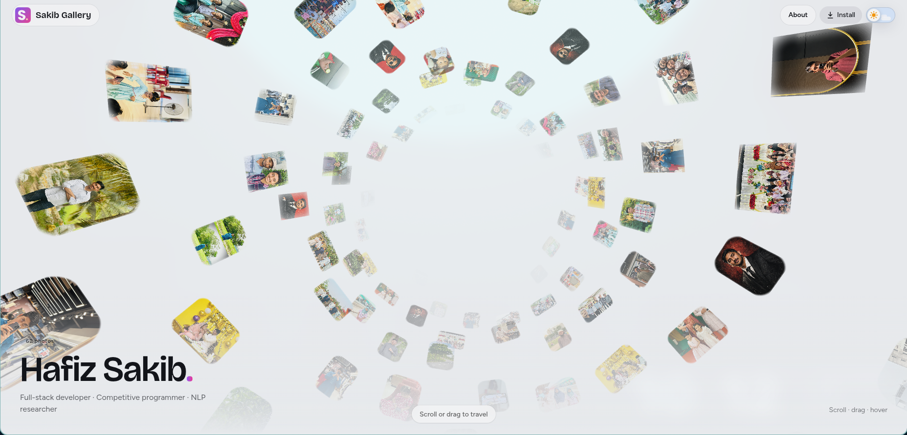

<div align="center">


# Sakib · Spatial Gallery

**A single-page WebGL photo tunnel you fly through. Installable PWA, day/night theme, zero backend.**
Drop in photos, run one command, publish to Vercel for free.


</div>

---

## Screenshot



> Scroll, drag or hover to travel through the tunnel. Click a photo to open the full-size image in a new tab.

---

## Table of contents

1. [Features](#features)
2. [Quick start](#quick-start)
3. [Where to put photos](#where-to-put-photos)
4. [What goes to GitHub (and what does not)](#what-goes-to-github-and-what-does-not)
5. [Photo pipeline](#photo-pipeline)
6. [PWA and Install button](#pwa-and-install-button)
7. [Project structure](#project-structure)
8. [Configuration](#configuration)
9. [Deploying to Vercel](#deploying-to-vercel)
10. [Scripts reference](#scripts-reference)
11. [Troubleshooting](#troubleshooting)
12. [Tech stack](#tech-stack)
13. [Author](#author)

---

## Features

- **Spatial tunnel**: WebGL gallery from [Motion Brew](https://motion-brew.com) (three.js + GSAP, code-split and loaded only when the page opens).
- **Extra pages**: besides the photo tunnel on the home page there are four interactive pages, **Skills**, **Journey**, **Coding** and **Contact**, reached from the top bar (`#/skills`, `#/journey`, `#/coding`, `#/contact`). They carry no project pictures. Edit their text in `src/about.js` and `src/site.js`.
- **Random every visit**: a fresh random set of up to 64 photos (`MAX_PHOTOS` in `src/App.jsx`) in a fresh order.
- **Automatic photo pipeline**: `npm run dev` converts every photo to WebP, auto-rotates it, strips GPS/EXIF, creates 3 sizes and numbers them oldest to newest.
- **Efficient**: the browser only ever downloads WebP. The tunnel uses the 900 px version, a click opens the 1600 px version. The photo list is a tiny JSON file, so 500 photos cost about the same JS as 5.
- **Originals stay local**: untouched originals are never committed to GitHub.
- **Installable PWA**: one click on **Install** opens the native install dialog. The button hides itself when the app is already installed.
- **Offline-ready**: service worker caches the app shell and every photo you open.
- **Day / night theme** with a circular reveal animation (remembered between visits).
- **Vercel-ready** with immutable caching headers for photos and assets.

---

## Quick start

Requirements: **Node.js 18+** and npm.

```bash
npm install        # 1. install dependencies
# 2. put your photos in photos/   (any format, HEIC included)
npm run dev        # 3. http://localhost:5173  (also converts + watches photos/)
npm run build      # 4. production build in dist/
npm run preview    #    preview the production build
```

`npm run dev` does everything by itself: it starts Vite, converts all photos that are waiting, and keeps watching for new ones. Leave it running and drop more photos in any time, the page reloads when they are ready.

---

## Where to put photos

| Folder | Use |
| --- | --- |
| **`photos/`** | Main inbox. Drop any photo here (jpg, png, webp, avif, tiff, gif, svg, **HEIC/HEIF**). |
| `src/images/` | Also works as an inbox (for your old originals). |
| `public/gallery/` | Generated WebP files. Photos pasted here by mistake are picked up too. |

After processing, your untouched originals are moved to **`originals/`** (backup, not committed), so `photos/` and `src/images/` end up empty.

---

## What goes to GitHub (and what does not)

| Path | Git | Why |
| --- | :---: | --- |
| `photos/*`, `src/images/*` | ignored | original, heavy photos |
| `originals/` | ignored | backup of the originals |
| `public/gallery/` | **committed** | the generated WebP files the browser shows |
| `src/gallery-meta.json` | **committed** | tiny photo list used by the site |
| `scripts/gallery-state.json` | **committed** | dates and hashes used for numbering and duplicate detection |
| `node_modules/`, `dist/` | ignored | build output |

After adding photos:

```bash
git add public/gallery src/gallery-meta.json scripts/gallery-state.json
git commit -m "Add photos"
git push
```

All the rules are in `.gitignore`.

---

## Photo pipeline

`scripts/prepare-gallery.mjs` runs inside `npm run dev` and `npm run build` (skipped on Vercel/CI, where the committed WebP files are used).

| Step | Result |
| --- | --- |
| Decode | HEIC/HEIF converted in memory (capture date is read first) |
| Process | Auto-rotated, resized, converted to WebP, GPS/EXIF removed |
| Sizes | `N.webp` (1600 px), `N-medium.webp` (900 px), `N-thumb.webp` (400 px) |
| Rename | All photos numbered `1, 2, 3 ...` from oldest to newest (EXIF date, else file date) |
| Duplicates | Same photo twice is detected by hash and skipped |
| Backup | Originals moved to `originals/` |
| Report | Prints the total size. Keep it under about 95 MB (Vercel Hobby static limit) |

- **Delete a photo**: delete `public/gallery/N.webp`. The next run cleans the other sizes and renumbers.
- **Change size or quality**: edit `TIERS` in `scripts/prepare-gallery.mjs`, then `npm run gallery:rebuild`.

---

## PWA and Install button

- Tap **Install** in the header. On Android and desktop Chrome/Edge the browser's install dialog opens immediately, so the app installs with one click.
- On browsers without an install dialog (iPhone Safari, Firefox) the button shows a short how-to (Share, then Add to Home Screen).
- The button is **hidden** when the app is already installed or opened as the installed app, and on Chromium browsers that do not offer an install (for example when it is already installed on that device).
- Name: **Sakib**. Icons: generated from the Sakib logo (transparent background) (`public/icons/`, `public/apple-touch-icon.png`, `public/favicon.ico`, `public/favicon-32.png`).
- The service worker is registered only in production (`npm run build` / Vercel), so the Install button appears on the deployed HTTPS site, not in `npm run dev`.
- Bump `VERSION` in `public/sw.js` to make every visitor drop the old caches.

---

## Project structure

```bash
spital/
├── docs/
│   ├── logo.png                  # Sakib logo (README)
│   └── screenshots/gallery.png   # screenshot used in this README
├── photos/                       # DROP YOUR PHOTOS HERE (git-ignored)
├── originals/                    # backups of processed originals (git-ignored, auto-created)
├── public/
│   ├── gallery/                  # generated WebP: N.webp, N-medium.webp, N-thumb.webp (committed)
│   ├── icons/                    # PWA icons (192, 512, transparent) + header logo
│   ├── favicon.ico, favicon-32.png, apple-touch-icon.png
│   ├── manifest.webmanifest      # PWA manifest
│   ├── sw.js                     # service worker
│   └── Hafiz-Sakib-CV.pdf
├── scripts/
│   ├── dev.mjs                   # `npm run dev`: Vite + photo watcher
│   ├── prepare-gallery.mjs       # photo pipeline
│   └── gallery-state.json        # generated (committed)
├── src/
│   ├── components/               # InstallButton, ThemeToggle, icons, Motion Brew spatial gallery
│   ├── App.jsx                   # page layout, header, About panel, tunnel
│   ├── gallery.js                # builds the photo list from gallery-meta.json
│   ├── gallery-meta.json         # generated (committed)
│   ├── site.js                   # your name, title, bio, social links, stats
│   ├── pwa.js                    # install prompt + "already installed" detection
│   ├── theme.js, index.css, main.jsx
│   └── images/                   # optional second inbox (git-ignored)
├── index.html, vite.config.js, vercel.json, package.json
└── .gitignore
```

---

## Configuration

`src/site.js`:

| Field | Used for |
| --- | --- |
| `title` | Header, browser tab (set the same in `index.html` and `public/manifest.webmanifest`) |
| `name`, `tagline`, `place`, `bio` | Big hero heading and About panel |
| `email`, `social` | About panel buttons and icons |
| `stats` | Numbers in the About panel |

Tunnel tuning (`src/App.jsx`): `MAX_PHOTOS`, and `count`, `radius`, `scrollSpeed`, `twist`, `roll` on `<SpatialGallery>`. Lower `MAX_PHOTOS` if old phones struggle (each photo is one GPU texture).

---

## Deploying to Vercel

1. Run `npm run dev` locally once so photos are converted, then commit `public/gallery`, `src/gallery-meta.json` and `scripts/gallery-state.json`.
2. Push to GitHub and import the repo in Vercel (Vite is detected: build `npm run build`, output `dist`).
3. `vercel.json` sets long-lived `immutable` caching for `/gallery/*` and `/assets/*` and revalidation for `sw.js` and the manifest.

---

## Scripts reference

| Command | What it does |
| --- | --- |
| `npm run dev` | Vite + converts `photos/` and `src/images/` + keeps watching. Extra flags work: `npm run dev -- --host` |
| `npm run build` | Converts photos (skipped on Vercel/CI), then builds to `dist/` |
| `npm run preview` | Serves the production build locally |
| `npm run photos` / `npm run convert` | Converts photos once without the dev server |
| `npm run gallery:rebuild` | Re-processes everything in `originals/` (after changing `TIERS`) |

---

## Troubleshooting

| Problem | Fix |
| --- | --- |
| "No photos yet" | Put photos in `photos/` and run `npm run dev` |
| `sharp is not installed` | Run `npm install` |
| New photos do not show | Keep `npm run dev` running, wait a few seconds, or run `npm run photos` |
| Old pictures after an update | Hard refresh, or bump `VERSION` in `public/sw.js` |
| No Install button | It shows only on the deployed HTTPS build, and hides when the app is already installed |
| Build too large for Vercel Hobby | Lower `width` / `quality` in `TIERS`, then `npm run gallery:rebuild` |

---

## Tech stack

[React 18](https://react.dev) · [Vite 6](https://vite.dev) · [Tailwind CSS 4](https://tailwindcss.com) · [Motion Brew](https://motion-brew.com) · [Framer Motion](https://motion.dev) · [GSAP](https://gsap.com) · [three.js](https://threejs.org) · [sharp](https://sharp.pixelplumbing.com) · [heic-convert](https://github.com/catdad-experiments/heic-convert) · [exifr](https://github.com/MikeKovarik/exifr)

---

## Author

**Hafiz Sakib** (Dev Sakib), full-stack developer, competitive programmer and NLP researcher from Chattogram, Bangladesh.

- GitHub: [Hafiz-Sakib](https://github.com/Hafiz-Sakib)
- Portfolio: [hafizsakib.vercel.app](https://hafizsakib.vercel.app)

The Spatial gallery component is from Motion Brew (MIT licensed).
